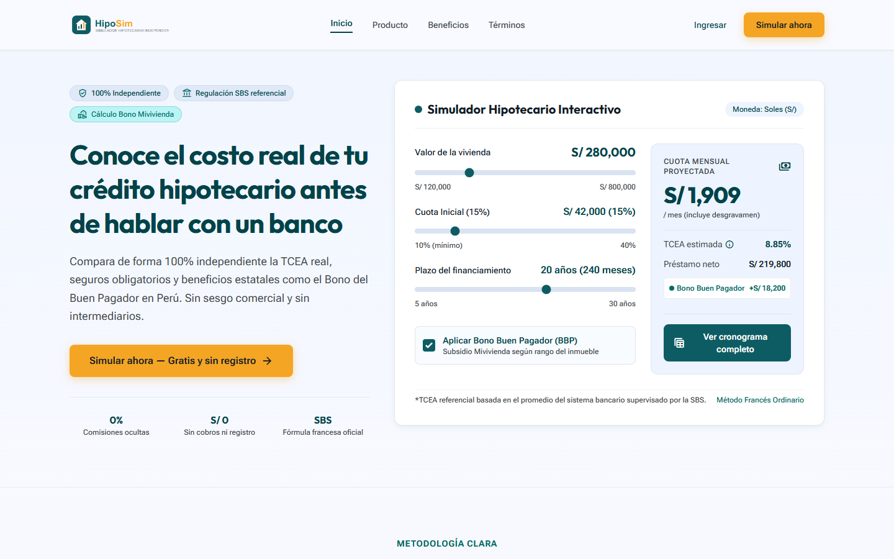
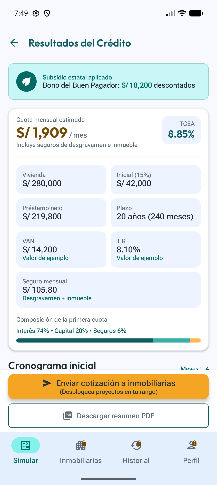
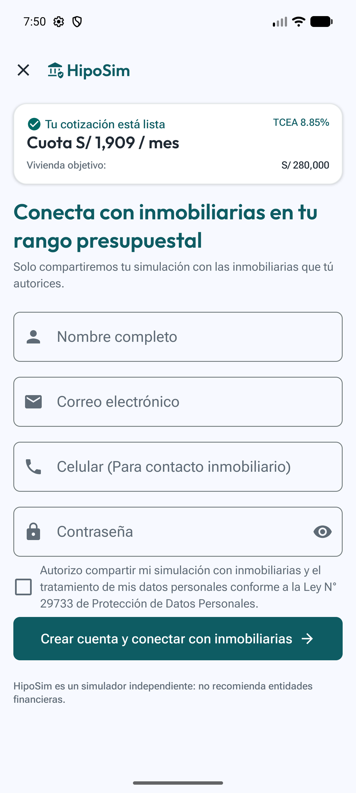

# **Chapter V: Product Implementation**

<div style="text-align: justify; line-height: 1.6;">

En AuraCode desarrollamos **HipoSim** como una solución de orientación hipotecaria para compradores de primera vivienda en el Perú. Organizamos el producto en una Landing Page pública, una aplicación web para asesores inmobiliarios, una aplicación móvil Android para compradores, una API RESTful y una base de datos relacional. Con esta distribución conectamos los requisitos definidos en el Capítulo III con las decisiones de arquitectura y experiencia de usuario del Capítulo IV.

Durante los dos primeros Sprints concentramos nuestros esfuerzos en la experiencia pública de simulación y en los componentes que permiten conectar al comprador con una inmobiliaria mediante consentimiento explícito. Documentamos tanto los avances obtenidos como las limitaciones de integración y publicación identificadas en esta etapa, sin considerar terminadas las funciones que aún dependen de otros módulos.

</div>

---

## **5.1. Software Configuration Management**

<div style="text-align:justify; line-height:1.6;">

Establecimos una estrategia de gestión de configuración para mantener la trazabilidad entre historias de usuario, componentes, cambios de código y entregas. Empleamos herramientas compartidas de seguimiento y repositorios independientes por producto, con convenciones orientadas a facilitar la revisión técnica y la integración colaborativa.

</div>

### **5.1.1. Software Development Environment Configuration**

<div style="text-align:justify; line-height:1.6;">

Seleccionamos las herramientas de acuerdo con la arquitectura de HipoSim. Para la experiencia web utilizamos Vue 3, Vite y PrimeVue; para la Landing Page, HTML, CSS y JavaScript; para Android, Kotlin y Jetpack Compose; y para los servicios, C# con ASP.NET Core, Entity Framework Core y PostgreSQL. Complementamos el desarrollo con Jira, GitHub y herramientas de diseño, documentación y validación de API.

</div>

<table style="width:100%; border-collapse:collapse; margin:16px 0;">
<thead><tr style="background-color:#0E5C63; color:#FFFFFF;"><th style="border:1px solid #B8C2CC; padding:10px;">Actividad</th><th style="border:1px solid #B8C2CC; padding:10px;">Herramienta</th><th style="border:1px solid #B8C2CC; padding:10px;">Propósito en HipoSim</th><th style="border:1px solid #B8C2CC; padding:10px;">Referencia</th></tr></thead>
<tbody>
<tr><td style="border:1px solid #B8C2CC; padding:9px;">Gestión del proyecto</td><td style="border:1px solid #B8C2CC; padding:9px;">Jira</td><td style="border:1px solid #B8C2CC; padding:9px;">Gestionamos épicas, historias de usuario, Sprint Backlogs, responsables y seguimiento del avance.</td><td style="border:1px solid #B8C2CC; padding:9px;"><a href="https://www.atlassian.com/software/jira">Sitio oficial</a></td></tr>
<tr style="background-color:#F7FAFC;"><td style="border:1px solid #B8C2CC; padding:9px;">Gestión de requerimientos</td><td style="border:1px solid #B8C2CC; padding:9px;">Jira y Markdown</td><td style="border:1px solid #B8C2CC; padding:9px;">Vinculamos los criterios de aceptación del backlog con la implementación y el informe.</td><td style="border:1px solid #B8C2CC; padding:9px;"><a href="https://www.markdownguide.org/">Markdown Guide</a></td></tr>
<tr><td style="border:1px solid #B8C2CC; padding:9px;">Diseño UX/UI</td><td style="border:1px solid #B8C2CC; padding:9px;">Figma</td><td style="border:1px solid #B8C2CC; padding:9px;">Diseñamos wireframes, mock-ups y flujos de las interfaces web y Android.</td><td style="border:1px solid #B8C2CC; padding:9px;"><a href="https://www.figma.com/">Sitio oficial</a></td></tr>
<tr style="background-color:#F7FAFC;"><td style="border:1px solid #B8C2CC; padding:9px;">Arquitectura y modelado</td><td style="border:1px solid #B8C2CC; padding:9px;">Structurizr y Lucidchart</td><td style="border:1px solid #B8C2CC; padding:9px;">Modelamos y revisamos los diagramas C4, de clases y de base de datos.</td><td style="border:1px solid #B8C2CC; padding:9px;"><a href="https://structurizr.com/">Structurizr</a> / <a href="https://www.lucidchart.com/">Lucidchart</a></td></tr>
<tr><td style="border:1px solid #B8C2CC; padding:9px;">Control de versiones</td><td style="border:1px solid #B8C2CC; padding:9px;">Git y GitHub</td><td style="border:1px solid #B8C2CC; padding:9px;">Registramos los cambios, aplicamos GitFlow y revisamos las contribuciones de los repositorios.</td><td style="border:1px solid #B8C2CC; padding:9px;"><a href="https://git-scm.com/">Git</a> / <a href="https://github.com/">GitHub</a></td></tr>
<tr style="background-color:#F7FAFC;"><td style="border:1px solid #B8C2CC; padding:9px;">Desarrollo web</td><td style="border:1px solid #B8C2CC; padding:9px;">VS Code, Node.js, Vue 3, Vite y PrimeVue</td><td style="border:1px solid #B8C2CC; padding:9px;">Desarrollamos una aplicación web modular y responsiva acorde con el diseño del Capítulo IV.</td><td style="border:1px solid #B8C2CC; padding:9px;"><a href="https://vuejs.org/">Vue</a> / <a href="https://vite.dev/">Vite</a></td></tr>
<tr><td style="border:1px solid #B8C2CC; padding:9px;">Landing Page</td><td style="border:1px solid #B8C2CC; padding:9px;">HTML5, CSS3, JavaScript y GitHub Pages</td><td style="border:1px solid #B8C2CC; padding:9px;">Implementamos la experiencia pública, el simulador básico, los beneficios y los contenidos legales.</td><td style="border:1px solid #B8C2CC; padding:9px;"><a href="https://developer.mozilla.org/">MDN Web Docs</a></td></tr>
<tr style="background-color:#F7FAFC;"><td style="border:1px solid #B8C2CC; padding:9px;">Backend</td><td style="border:1px solid #B8C2CC; padding:9px;">Visual Studio/Rider, .NET, C#, ASP.NET Core y Entity Framework Core</td><td style="border:1px solid #B8C2CC; padding:9px;">Desarrollamos autenticación, cálculos financieros y persistencia; reservamos reportes y administración avanzada para otra iteración.</td><td style="border:1px solid #B8C2CC; padding:9px;"><a href="https://dotnet.microsoft.com/">.NET</a></td></tr>
<tr><td style="border:1px solid #B8C2CC; padding:9px;">Base de datos</td><td style="border:1px solid #B8C2CC; padding:9px;">PostgreSQL y pgAdmin</td><td style="border:1px solid #B8C2CC; padding:9px;">Organizamos la persistencia de usuarios, inmobiliarias, simulaciones y leads.</td><td style="border:1px solid #B8C2CC; padding:9px;"><a href="https://www.postgresql.org/">PostgreSQL</a></td></tr>
<tr style="background-color:#F7FAFC;"><td style="border:1px solid #B8C2CC; padding:9px;">Pruebas y documentación de API</td><td style="border:1px solid #B8C2CC; padding:9px;">Swagger/OpenAPI y Postman</td><td style="border:1px solid #B8C2CC; padding:9px;">Describimos endpoints y contrastamos solicitudes, respuestas y reglas de autorización.</td><td style="border:1px solid #B8C2CC; padding:9px;"><a href="https://swagger.io/specification/">OpenAPI</a></td></tr>
<tr><td style="border:1px solid #B8C2CC; padding:9px;">Documentación</td><td style="border:1px solid #B8C2CC; padding:9px;">Markdown, HTML y GitHub</td><td style="border:1px solid #B8C2CC; padding:9px;">Mantenemos el informe técnico bajo control de versiones y preparado para su exportación a PDF.</td><td style="border:1px solid #B8C2CC; padding:9px;"><a href="https://docs.github.com/en/get-started/writing-on-github">GitHub Docs</a></td></tr>
</tbody></table>

#### **Local Development Environment Baseline**

```text
Gestión del proyecto: Jira
Gestor de paquetes web: npm
Frontend web: Vue 3, Vite y PrimeVue
Landing Page: HTML5, CSS3 y JavaScript
Aplicación Android: Kotlin, Jetpack Compose y Material 3
Servicios REST: C# y ASP.NET Core
Persistencia: Entity Framework Core y PostgreSQL
Control de versiones: Git y GitHub
Especificación de servicios: OpenAPI/Swagger
Pruebas de servicios: Postman y pruebas automatizadas del proyecto .NET
```

### **5.1.2. Source Code Management**

<div style="text-align:justify; line-height:1.6;">

Concentramos el código fuente en la organización de GitHub de AuraCode y separamos los repositorios de cada producto. Esta organización nos permite revisar cambios de manera independiente, mantener un historial de contribuciones y relacionar las funcionalidades del backlog con Pull Requests. En el repositorio de servicios agrupamos la API y el trabajo asociado a su validación.

</div>

| Producto | Repositorio | Código fuente |
|:--|:--|:--|
| Landing Page | `hiposim-LandingPage` | [GitHub - Landing Page](https://github.com/auracode-exp-design-1asi0732-2620-9104/hiposim-LandingPage) |
| Aplicación Web Frontend | `hiposim-webApp` | [GitHub - Web App](https://github.com/auracode-exp-design-1asi0732-2620-9104/hiposim-webApp) |
| Aplicación Móvil Android | `hiposim-app-mobile` | [GitHub - Mobile App](https://github.com/auracode-exp-design-1asi0732-2620-9104/hiposim-app-mobile) |
| Backend y API RESTful | `hiposim-backEnd` | [GitHub - Backend](https://github.com/auracode-exp-design-1asi0732-2620-9104/hiposim-backEnd) |

#### **GitFlow Workflow**

<div style="text-align:justify; line-height:1.6;">

Adoptamos **GitFlow** para separar el trabajo estable de las funcionalidades en desarrollo. Utilizamos `main` como referencia de versiones estables y `develop` como rama de integración; las ramas `feature/*` concentran cambios funcionales, mientras que `release/*` y `hotfix/*` permiten distinguir la preparación de versiones y la corrección de incidencias. Las integraciones se canalizan mediante Pull Requests y revisiones entre integrantes.

Aplicamos **Semantic Versioning** en la identificación de entregas y **Conventional Commits** en los mensajes de cambio. Esto facilita localizar correcciones, nuevas funcionalidades y modificaciones documentales en el historial de los repositorios.

</div>

```text
feat(simulation): calculate mortgage installments with French amortization
feat(benefits): evaluate Good Payer Bonus eligibility
fix(auth): prevent access with an expired token
docs(api): document simulation endpoints
test(financial-engine): add TCEA calculation cases
```

### **5.1.3. Source Code Style Guide & Conventions**

<div style="text-align:justify; line-height:1.6;">

Acordamos utilizar identificadores técnicos en inglés y respetar las convenciones propias de cada lenguaje. En el frontend priorizamos componentes reutilizables y responsabilidades separadas; en el backend, servicios con dependencias explícitas, DTO validados y nombres consistentes con el dominio hipotecario. Para las especificaciones de comportamiento seguimos el vocabulario de las historias de usuario y la sintaxis Gherkin. Los textos de las interfaces se organizan para ofrecer español e inglés sin duplicar lógica de presentación.

</div>

| Tecnología | Convenciones principales | Referencia |
|:--|:--|:--|
| HTML5 | Elementos semánticos, etiquetas en minúscula, textos `alt` significativos, etiquetas asociadas a campos e indentación consistente. | [Google HTML/CSS Style Guide](https://google.github.io/styleguide/htmlcssguide.html) |
| CSS | Enfoque mobile-first, tokens reutilizables, clases kebab-case, ausencia de valores mágicos y contraste WCAG AA. | [Google HTML/CSS Style Guide](https://google.github.io/styleguide/htmlcssguide.html) |
| JavaScript | `const` por defecto, camelCase para variables y funciones, PascalCase para clases, igualdad estricta y async/await. | [Google JavaScript Style Guide](https://google.github.io/styleguide/jsguide.html) |
| Vue | Componentes PascalCase de varias palabras, un componente por archivo, props explícitas y lógica de negocio en servicios/composables. | [Vue Style Guide](https://vuejs.org/style-guide/) |
| C# / ASP.NET Core | PascalCase para miembros públicos, camelCase para parámetros, sufijo Async, inyección de dependencias y validación de DTO. | [C# Coding Conventions](https://learn.microsoft.com/dotnet/csharp/fundamentals/coding-style/coding-conventions) |
| Gherkin | Un comportamiento por escenario, pasos Dado que-Cuando-Entonces declarativos y lenguaje del negocio. | [Gherkin Reference](https://cucumber.io/docs/gherkin/) |

| Elemento | Convención | Ejemplo |
|:--|:--|:--|
| Componente Vue | PascalCase | `SimulationResults.vue` |
| Variable/función JavaScript | camelCase | `calculateMonthlyPayment` |
| Clase/interfaz C# | PascalCase / prefijo `I` | `SimulationService`, `ISimulationRepository` |
| Recurso REST | Sustantivo plural en minúscula | `/api/simulations` |
| Tabla de base de datos | snake_case plural | `simulation_reports` |
| Variable de entorno | UPPER_SNAKE_CASE | `DATABASE_CONNECTION_STRING` |
| Prueba | Nombre orientado al comportamiento | `Calculate_WhenInputIsValid_ReturnsSchedule` |

### **5.1.4. Software Deployment Configuration**

<div style="text-align:justify; line-height:1.6;">

Diferenciamos el despliegue público de la Landing Page del proceso de publicación de la aplicación web, la API y Android. La Landing Page constituye el producto con una dirección pública documentada en esta entrega. Para los otros componentes mantenemos código versionado y procedimientos de compilación e integración, pero no contamos en el informe con una publicación productiva acreditada.

</div>

#### **Landing Page Deployment**

<div style="text-align:justify; line-height:1.6;">

Publicamos la Landing Page mediante GitHub Pages desde el repositorio dedicado. La publicación ofrece navegación por las secciones de producto, beneficios y preguntas frecuentes, junto con el acceso al simulador básico. Utilizamos la dirección HTTPS del sitio como referencia compartida para comprobar su disponibilidad y contrastar la presentación de contenidos en escritorio y móvil.

</div>

#### **Frontend Web Application Deployment**

<div style="text-align:justify; line-height:1.6;">

Trabajamos la aplicación del asesor con un proyecto Vue y Vite. El proceso de construcción contempla la instalación reproducible de dependencias con `npm ci`, la compilación mediante `npm run build` y la configuración de la URL base de la API mediante variables de entorno. Durante esta entrega el portal se encuentra documentado como una aplicación ejecutada localmente; la autenticación y la gestión de leads todavía requieren comprobarse sobre la API integrada antes de considerarse un despliegue completo.

</div>

#### **RESTful API and Database Deployment**

<div style="text-align:justify; line-height:1.6;">

Desarrollamos los servicios con ASP.NET Core y organizamos la persistencia con Entity Framework Core y PostgreSQL. El flujo técnico distingue la restauración de dependencias, la compilación, la ejecución de pruebas y la aplicación controlada de migraciones. Tratamos la cadena de conexión, las claves JWT, la configuración CORS y las credenciales de prueba como información de configuración que no pertenece al código público. La URL de una API productiva no está acreditada en la versión del informe utilizada para esta entrega.

</div>

#### **Native Mobile Application Deployment**

<div style="text-align:justify; line-height:1.6;">

Desarrollamos la experiencia nativa para Android y la ejecutamos en emulador o dispositivo de prueba. El proyecto incorpora verificaciones automatizadas y una configuración de integración continua en GitHub Actions. Distinguimos esta ejecución de desarrollo de una distribución pública: en la etapa documentada no se registra la entrega de una APK de producción ni una publicación en una tienda de aplicaciones. La implementación nativa de iOS tampoco forma parte de las evidencias técnicas de este capítulo.

</div>

| Producto | Estado documentado | Referencia |
|:--|:--|:--|
| Landing Page | Publicada en GitHub Pages mediante HTTPS. | [Sitio público de HipoSim](https://auracode-exp-design-1asi0732-2620-9104.github.io/hiposim-LandingPage/) |
| Aplicación Web Frontend | Disponible como proyecto de desarrollo; sin URL productiva acreditada. | [Repositorio web](https://github.com/auracode-exp-design-1asi0732-2620-9104/hiposim-webApp) |
| API RESTful | Componentes desarrollados e integración en curso; sin URL productiva acreditada. | [Repositorio backend](https://github.com/auracode-exp-design-1asi0732-2620-9104/hiposim-backEnd) |
| Aplicación Móvil Android | Código y pruebas en el repositorio; sin distribución pública acreditada. | [Repositorio móvil](https://github.com/auracode-exp-design-1asi0732-2620-9104/hiposim-app-mobile) |

<div style="page-break-before:always;"></div>

## **5.2. Product Implementation & Deployment**

<div style="text-align:justify; line-height:1.6;">

Organizamos la implementación mediante el Product Backlog del Capítulo III, administrado en Jira. Dividimos el desarrollo en un primer Sprint centrado en la experiencia pública y en las bases de las aplicaciones, y un segundo Sprint dedicado al motor financiero, la autenticación, el intercambio de datos y la gestión de interesados por inmobiliaria. Priorizamos la continuidad del flujo principal antes que el historial de simulaciones, el comparador, la exportación de PDF y la administración avanzada de parámetros.

</div>

### **5.2.1. Sprint Backlogs**

<div style="text-align:justify; line-height:1.6;">

Distribuimos las historias funcionales y técnicas entre los integrantes de acuerdo con su dependencia y especialidad. El primer Sprint comprendió la Landing Page, el entorno Vue y la decisión tecnológica de Android; el segundo se enfocó en relacionar la aplicación del comprador, la API y el portal del asesor. Las estimaciones expresadas en Story Points representan capacidad planificada y no equivalen, por sí solas, a funcionalidades verificadas.

</div>

#### **Sprint 1 - Landing Page and Foundations**

| Campo | Descripción |
|:--|:--|
| Sprint | Sprint 1 |
| Sprint Goal | Nos enfocamos en publicar una experiencia inicial que permitiera conocer HipoSim, revisar beneficios estatales y ejecutar una simulación básica sin crear una cuenta, mientras organizábamos las bases del frontend web y Android. |
| Story Points planificados | **26** |
| Historias y actividades | TS04, US14, US15, US16, US17, US18, US19, US20, TS01, SP03 y actividades de diseño UX/UI. |
| Resultado principal | Landing Page publicada; bases de web y Android registradas en sus repositorios. |

**Sprint Backlog 1**

| ID | Historia o elemento | SP | Trabajo asociado |
|:---:|:--|---:|:--|
| TS04 | Configurar y publicar el Landing Page | 3 | Estructuración del sitio, aplicación de estilos, revisión de accesibilidad y publicación en GitHub Pages. |
| US14 | Ver propuesta de valor | 2 | Redacción y presentación responsiva de la propuesta independiente de HipoSim. |
| US15 | Simular crédito sin registro desde el Landing Page | 5 | Formulario de entrada, cálculo hipotecario en JavaScript y visualización de condiciones y beneficios. |
| US16 | Conocer beneficios estatales | 2 | Contenido y estructura visual dedicados al Bono del Buen Pagador y Mivivienda. |
| US17 | Consultar Términos y Condiciones y Privacidad | 2 | Contenido legal y acceso a la información sobre tratamiento de datos personales. |
| US18 | Consultar preguntas frecuentes | 2 | Organización de consultas habituales y sus respuestas en el sitio público. |
| US19 | Contactar al equipo de HipoSim | 2 | Interfaz de contacto y validación de datos; el envío no utiliza un servicio backend. |
| US20 | Cambiar el idioma del sitio | 3 | Recursos de español e inglés, selector de idioma y conservación de la preferencia del usuario. |
| TS01 | Configurar entorno de frontend | 3 | Proyecto Vue con Vite y PrimeVue, estructura de carpetas y configuración inicial de navegación. |
| SP03 | Definir la tecnología de la app móvil nativa | 2 | Evaluación de alternativas y decisión de utilizar Kotlin y Jetpack Compose para Android. |
| DS | Diseños de interfaz relacionados | — | Mock-ups de registro y resultados móviles, bandeja de leads y ficha del interesado. |

#### **Sprint 2 - API, Buyer Mobile App and Advisor Web App**

| Campo | Descripción |
|:--|:--|
| Sprint | Sprint 2 |
| Sprint Goal | Nos enfocamos en vincular las simulaciones del comprador con el motor financiero y en hacer posible el envío autorizado de interesados a las inmobiliarias, con seguimiento desde el portal del asesor. |
| Story Points planificados | **56** |
| Historias y actividades | SP02, TS02, TS07, TS06, TS05, TS08, US13, US26, US01, US04, US05, US02, US21, US22, US23, US24 y US25. |
| Estado del alcance | El motor financiero, la infraestructura inicial del backend y los servicios de autenticación y simulación registran avances; la integración completa de leads entre Android y la web permanece en desarrollo en la documentación de TB1. |

**Sprint Backlog 2**

| ID | Historia o elemento | SP | Producto | Trabajo asociado |
|:---:|:--|---:|:--|:--|
| SP02 | Validar la adaptación del motor financiero a C# | 3 | API | Conversión y contraste de los cálculos financieros frente a los casos de referencia de AutoFinance Pro. |
| TS02 | Implementar backend y base de datos | 5 | API | Solución ASP.NET Core, entidades de dominio, DbContext, PostgreSQL y migraciones. |
| TS07 | Exponer endpoints de autenticación | 3 | API | Registro, inicio de sesión y autorización JWT diferenciada por roles. |
| TS06 | Exponer endpoint de simulación | 5 | API | Contrato de entrada, validaciones y ejecución del motor hipotecario. |
| TS05 | Documentar la API con OpenAPI/Swagger | 2 | API | Definición de esquemas, respuestas, ejemplos y códigos de estado de los servicios. |
| TS08 | Exponer endpoints de leads | 5 | API | Registro consentido, consulta por inmobiliaria, ficha del lead, estados y notas. |
| US13 | Registrarse como Comprador | 2 | Android | Vinculación del registro contextual con `/api/auth/register` y aceptación de términos y datos personales. |
| US26 | Iniciar sesión como Comprador | 2 | Android | Autenticación desde la aplicación móvil mediante `/api/auth/login`. |
| US01 | Simular crédito base | 5 | Android | Formulario de precio, cuota inicial, plazo y comunicación con `/api/simulations`. |
| US04 | Visualizar TCEA, VAN y TIR | 5 | Android | Presentación de indicadores calculados por el servicio de simulación. |
| US05 | Aplicar Bono del Buen Pagador | 3 | Android | Cálculo con el indicador `applyGoodPayerBonus` y actualización de resultados. |
| US02 | Ver cronograma de pagos | 3 | Android | Distribución mensual de intereses, amortización y saldo pendiente. |
| US21 | Enviar una simulación a inmobiliarias con consentimiento | 3 | Android y API | Selección de inmobiliaria y transferencia de la simulación autorizada. |
| US22 | Iniciar sesión como Asesor | 2 | Web | Autenticación del asesor y control de acceso a la aplicación web. |
| US23 | Ver bandeja de leads | 3 | Web | Consulta de interesados asociados con la inmobiliaria del asesor. |
| US24 | Ver ficha del lead | 3 | Web | Visualización de los datos compartidos y del seguimiento comercial. |
| US25 | Gestionar estado y seguimiento del lead | 2 | Web | Actualización de estados y registro de notas de contacto. |

<div style="text-align:justify; line-height:1.6;">

Registramos el seguimiento individual de las actividades en Jira y trabajamos las integraciones por repositorio y Pull Request. En esta entrega mantenemos fuera del alcance implementado el guardado y comparación de escenarios (US06 y US07), la exportación de informes PDF (US08), el periodo de gracia avanzado (US03) y las funciones administrativas de parámetros (US09 a US12).

</div>

### **5.2.2. Implemented Landing Page Evidence**

<div style="text-align:justify; line-height:1.6;">

Implementamos la Landing Page como primer punto de contacto con el comprador de primera vivienda. Su estructura presenta la propuesta de valor de HipoSim, los beneficios estatales, las preguntas frecuentes, el formulario de contacto y la información legal. Incluimos un simulador básico de cuota hipotecaria con precio del inmueble, cuota inicial y plazo, sin exigir registro previo; también incorporamos la opción relacionada con el Bono del Buen Pagador.

Utilizamos HTML, CSS y JavaScript, con recursos de estilo responsivo y una identidad visual basada en verde azulado (`#0E5C63`), turquesa (`#3AAFA9`) y ámbar (`#F5A524`). Definimos Outfit para títulos y Roboto Flex para el contenido. La versión pública incorpora navegación, selector de idioma y accesos a la simulación desde escritorio y móvil.

La tasa anual del **8,85 %** utilizada como referencia en el cálculo de la Landing Page corresponde a una **TEA**, no a una TCEA comprobada, porque el cálculo público descrito no incorpora todos los seguros y gastos asociados al crédito. Detectamos diferencias con los valores referenciales utilizados en la aplicación móvil y la API, por lo que distinguimos expresamente la cuota financiera de cualquier cuota total que incluya cargos adicionales. El formulario de contacto utiliza validación de entrada, pero no cuenta con envío real conectado a un backend en la etapa documentada.

</div>

| Aspecto | Información del producto |
|:--|:--|
| Repositorio | [hiposim-LandingPage](https://github.com/auracode-exp-design-1asi0732-2620-9104/hiposim-LandingPage) |
| Sitio publicado | [HipoSim en GitHub Pages](https://auracode-exp-design-1asi0732-2620-9104.github.io/hiposim-LandingPage/) |
| Historias relacionadas | TS04, US14, US15, US16, US17, US18, US19 y US20. |
| Experiencia disponible | Inicio, Producto, Beneficios, Preguntas, información legal, contacto y simulador básico. |
| Internacionalización | Contenidos en español e inglés, con preferencia de idioma en el navegador. |
| Alcance financiero | Estimación de cuota con TEA referencial; no equivale a evaluación crediticia bancaria ni a oferta vinculante. |

<div align="center">
  
  <p><em>Figura 1. Landing Page implementada de HipoSim (escritorio).</em></p>
</div>

<div align="center">
  
  <p><em>Figura 2. Landing Page implementada de HipoSim (móvil).</em></p>
</div>

### **5.2.3. Implemented Frontend-Web Application Evidence**

<div style="text-align:justify; line-height:1.6;">

Desarrollamos la aplicación web como portal de atención para el asesor inmobiliario. Utilizamos Vue 3, Vite, PrimeVue, Pinia y Axios para organizar la navegación, el estado y la comunicación con los servicios. En la fase documentada disponemos de vistas de inicio de sesión, registro de inmobiliaria, bandeja y ficha de leads, resumen, notificaciones y configuración, con datos de ejemplo. Este estado nos permitió avanzar en la experiencia del asesor antes de completar los endpoints del backend.

El flujo funcional relaciona la autenticación del asesor con la consulta de los interesados que autorizaron compartir su simulación, el acceso a su ficha y la actualización del seguimiento. La conexión de estas vistas con los datos reales de la API continúa siendo parte de la integración del Sprint 2; por ello no consideramos que la existencia de una pantalla con datos de ejemplo demuestre la integración definitiva.

</div>

| Módulo | Requerimiento | Estado documentado |
|:--|:--|:--|
| Autenticación del asesor | US22 | Vista disponible; conexión con JWT de la API en desarrollo. |
| Bandeja de leads | US23 | Interfaz con datos de ejemplo; consulta a backend asociada a TS08. |
| Ficha del lead | US24 | Vista del interesado; integración de datos compartidos dependiente de los endpoints de leads. |
| Estado y notas | US25 | Flujo de seguimiento definido; persistencia real dependiente del servicio de leads. |
| Registro de inmobiliaria | Soporte del portal | Pantalla de interfaz existente; gestión real de cuentas delimitada por el backend. |
| Resumen, notificaciones y configuración | Vistas complementarias | Presentación inicial sin cobertura completa de servicios productivos. |

<div style="text-align:justify; line-height:1.6;">

Mantenemos el código del portal en [hiposim-webApp](https://github.com/auracode-exp-design-1asi0732-2620-9104/hiposim-webApp). En la entrega documentada la aplicación web se ejecuta en desarrollo local y no presenta una URL productiva acreditada.

</div>

### **5.2.4. Implemented Native-Mobile Application Evidence**

<div style="text-align:justify; line-height:1.6;">

Construimos la aplicación Android nativa como experiencia principal del comprador. Seleccionamos Kotlin, Jetpack Compose y Material 3, junto con Hilt, Navigation Compose y ViewModel con StateFlow, conforme a la decisión técnica registrada para SP03. En el primer Sprint desarrollamos la presentación de resultados hipotecarios y el registro contextual con datos de ejemplo; en el segundo Sprint concentramos el trabajo en la comunicación con la API mediante Retrofit y en los flujos de simulación, autenticación y envío consentido a una inmobiliaria.

El alcance funcional contempla la validación de una cuota inicial mínima del 10 %, la consulta de la cuota y de los indicadores financieros (TCEA, VAN y TIR), la visualización del cronograma y el uso opcional del Bono del Buen Pagador. Distinguimos las pantallas existentes de las historias cuya integración depende de servicios aún no integrados, especialmente la creación de leads y su recepción en el portal del asesor.

</div>

| Aspecto | Información documentada |
|:--|:--|
| Repositorio | [hiposim-app-mobile](https://github.com/auracode-exp-design-1asi0732-2620-9104/hiposim-app-mobile) |
| Plataforma | Android nativo, `minSdk 26` y `targetSdk 36`. |
| Integración | Kotlin, Jetpack Compose, Retrofit y arquitectura de presentación basada en ViewModel. |
| Historias vinculadas | SP03, US13, US26, US01, US04, US05, US02 y US21. |
| Verificación reportada | 35 pruebas unitarias y 4 pruebas de interfaz en emulador, además de comprobaciones con ktlint y Android lint. |
| Integración continua | Flujo de GitHub Actions descrito para el repositorio móvil. |
| Distribución | Ejecución de desarrollo en emulador/dispositivo; sin distribución pública acreditada. |

<div align="center">
  
  
  <p><em>Figura 3. Resultados del crédito y Registro Contextual de la aplicación Android.</em></p>
</div>

### **5.2.5. Implemented RESTful API and/or Serverless Backend Evidence**

<div style="text-align:justify; line-height:1.6;">

Desarrollamos el backend sobre ASP.NET Core, Entity Framework Core y PostgreSQL, con responsabilidades separadas para autenticación, simulación y administración de interesados. Establecimos una base de datos relacional para los usuarios, las inmobiliarias, las simulaciones y los leads, y utilizamos JWT para representar la identidad y los permisos de comprador y asesor.

Adaptamos el motor de cálculo financiero a C# y definimos `POST /api/simulations` como servicio central para obtener la cuota, los indicadores y el cronograma de amortización. La adaptación y la validación del motor (SP02), junto con el endpoint de simulación (TS06), figuran entre los trabajos reportados como realizados por el equipo. La autenticación requiere cerrar correcciones de pruebas e integración, mientras que la gestión de leads y la conexión completa entre aplicaciones forman parte del trabajo todavía abierto del Sprint 2.

</div>

| Componente | Responsabilidad | Alcance documentado |
|:--|:--|:--|
| `AuthController` / `AuthService` | Registro, inicio de sesión y autorización JWT. | Base implementada; validación e integración en revisión. |
| `SimulationController` / `SimulationService` | Validaciones y cálculo hipotecario a través del motor financiero. | Desarrollo del servicio reportado para TS06. |
| `FinancialEngine` | Amortización francesa, tasas e indicadores VAN, TIR y TCEA. | Port a C# y contraste financiero registrados en SP02. |
| `BenefitsEngine` | Evaluación y aplicación del Bono del Buen Pagador. | Lógica asociada a simulación y a US05. |
| `LeadController` / `LeadService` | Envío autorizado, listado, ficha, estados y notas. | Integración funcional en desarrollo durante TS08. |
| Persistencia con Entity Framework Core | Entidades y migraciones sobre PostgreSQL. | Base del servicio definida en TS02. |
| `ScenarioController` / `ScenarioService` | Guardado y comparación de escenarios. | Funcionalidad reservada a una iteración posterior. |
| `ReportController` / `ReportGenerationService` | Exportación de simulaciones a PDF. | Funcionalidad reservada a una iteración posterior. |
| `AdminController` / `AdminParameterService` | Mantenimiento de parámetros y auditoría. | Funcionalidad reservada a una iteración posterior. |

<div style="text-align:justify; line-height:1.6;">

Centralizamos el trabajo del backend en [hiposim-backEnd](https://github.com/auracode-exp-design-1asi0732-2620-9104/hiposim-backEnd). Para esta entrega no contamos con evidencias consolidadas de una URL pública de producción, una ejecución completa de la batería de pruebas del backend ni la operación del flujo comprador–asesor en un entorno desplegado. Esta distinción nos permite documentar el avance técnico sin atribuir al producto una cobertura que todavía no hemos demostrado.

</div>

#### **Leads Management Backend Evidence (TS08)**

<div style="text-align:justify; line-height:1.6;">

Durante el Sprint 2 implementamos el módulo de gestión de interesados (TS08) en el backend de HipoSim, utilizando ASP.NET Core, C#, Entity Framework Core y PostgreSQL. Su desarrollo permite registrar solicitudes de contacto autorizadas por compradores y gestionar su seguimiento desde el rol de asesor inmobiliario.

La implementación incorpora `LeadsController` y `LeadService`, responsables de las operaciones de creación, consulta, actualización de estados y registro de notas. Asimismo, se incorporaron las entidades `Lead`, `LeadNote` y `LeadStatusChange` para almacenar las solicitudes y mantener la trazabilidad del seguimiento comercial.

</div>

| Componente implementado | Responsabilidad | Evidencia de implementación |
|:--|:--|:--|
| `LeadsController` | Exponer los cinco endpoints REST del módulo. | Controlador desarrollado en el backend. |
| `LeadService` | Gestionar solicitudes, estados, notas y restricciones de acceso. | Servicio de aplicación implementado. |
| `Lead` | Almacenar los datos principales de la solicitud y el consentimiento. | Entidad incorporada a la persistencia. |
| `LeadNote` | Registrar observaciones de seguimiento. | Entidad relacionada con los leads. |
| `LeadStatusChange` | Mantener el historial de cambios de estado. | Entidad de trazabilidad implementada. |
| Entity Framework Core | Gestionar la persistencia relacional de leads. | Migración `AddLeadsManagement` incorporada. |

<div style="text-align:justify; line-height:1.6;">

Para la seguridad de los servicios se utiliza autenticación JWT y autorización según el rol del usuario. Las consultas y operaciones de seguimiento restringen el acceso a los interesados asociados con la inmobiliaria del asesor, mientras que la creación de solicitudes exige consentimiento explícito del comprador.

La implementación también fue sometida a pruebas automatizadas de los endpoints REST. En la última ejecución registrada, el backend obtuvo **188 pruebas satisfactorias**, incluyendo **10 pruebas correspondientes a TS08**. Estas verificaciones abarcan las operaciones principales y las restricciones de acceso del módulo.

La evidencia corresponde a la implementación y validación del backend; no constituye evidencia de un despliegue público en producción ni de una integración completa entre las aplicaciones móvil y web.

</div>

### **5.2.6. RESTful API Documentation**

<div style="text-align:justify; line-height:1.6;">

Organizamos los recursos REST de acuerdo con los casos de uso del comprador, el asesor y la administración de parámetros. Definimos el contrato alrededor de autenticación, simulación hipotecaria y leads autorizados, diferenciando los endpoints tratados en el Sprint 2 de los recursos que corresponden a historias posteriores. Utilizamos OpenAPI/Swagger para describir solicitudes y respuestas y Postman como apoyo para la comprobación de las interacciones de servicio.

</div>

| Método | Recurso | Propósito | Requerimiento | Situación en TB1 |
|:--:|:--|:--|:--:|:--|
| `POST` | `/api/auth/register` | Registrar una cuenta de comprador. | US13, TS07 | Servicio desarrollado; integración móvil en revisión. |
| `POST` | `/api/auth/login` | Autenticar compradores y asesores. | US22, US26, TS07 | Servicio desarrollado; ajustes de pruebas y respuesta de asesor en proceso de corrección. |
| `POST` | `/api/simulations` | Calcular una simulación hipotecaria. | US01, US04, US05, TS06 | Implementación reportada; homologación de parámetros entre clientes en revisión. |
| `GET` | `/api/agencies` | Consultar inmobiliarias disponibles. | US21 | Integración necesaria para el envío consentido. |
| `POST` | `/api/leads` | Crear un lead a partir de una simulación autorizada. | US21, TS08 | Desarrollo e integración de leads. |
| `GET` | `/api/leads` | Listar los leads de la inmobiliaria del asesor. | US23, TS08 | Desarrollo e integración de leads. |
| `GET` | `/api/leads/{id}` | Consultar la ficha de un lead. | US24, TS08 | Desarrollo e integración de leads. |
| `PATCH` | `/api/leads/{id}/status` | Actualizar el estado del interesado. | US25, TS08 | Desarrollo e integración de leads. |
| `POST` | `/api/leads/{id}/notes` | Registrar notas del asesor. | US25, TS08 | Desarrollo e integración de leads. |
| `GET` | `/health` | Consultar el estado del servicio. | TS02 | Endpoint identificado en la documentación técnica del backend. |
| `GET` | `/api/simulations/{id}` | Recuperar una simulación autorizada. | US02, US06 | Alcance asociado a consulta e historial. |
| `GET` | `/api/simulations` | Obtener simulaciones guardadas. | US06 | Iteración posterior. |
| `POST` | `/api/comparisons` | Comparar escenarios de crédito. | US07 | Iteración posterior. |
| `GET` | `/api/simulations/{id}/report` | Obtener un informe PDF. | US08, TS03 | Iteración posterior. |
| `GET` | `/api/admin/parameters` | Consultar parámetros financieros. | US09, US10 | Iteración posterior. |
| `PUT` | `/api/admin/parameters/{key}` | Modificar un parámetro autorizado. | US09, US10 | Iteración posterior. |
| `POST` | `/api/admin/parameters/{key}/preview` | Previsualizar un cambio. | US11 | Iteración posterior. |
| `GET` | `/api/admin/parameters/{key}/history` | Consultar cambios históricos. | US12 | Iteración posterior. |

#### **Mortgage Simulation Contract**

<div style="text-align:justify; line-height:1.6;">

Definimos la solicitud de simulación mediante el precio de la vivienda, la cuota inicial, la tasa anual efectiva, el plazo expresado en meses y la decisión de aplicar el Bono del Buen Pagador. Como caso de contraste entre productos tomamos una vivienda de **S/ 280 000**, una inicial de **S/ 42 000** y un plazo de **240 meses**. La tasa de **8,85 % TEA** corresponde a la referencia visible en la Landing Page y constituye el valor que identificamos para homogeneizar los cálculos, sin afirmar que todas las aplicaciones ya estén utilizando la misma configuración.

</div>

```json
{
  "propertyPrice": 280000.00,
  "downPayment": 42000.00,
  "annualEffectiveRate": 0.0885,
  "termInMonths": 240,
  "gracePeriodMonths": 0,
  "graceType": "none",
  "applyGoodPayerBonus": true
}
```

<div style="text-align:justify; line-height:1.6;">

La respuesta del motor financiero se organiza alrededor del capital financiado, la cuota mensual, el cronograma de amortización, los indicadores financieros y el beneficio aplicado. En el contraste entre la Landing Page, la aplicación Android y la API identificamos discrepancias en las tasas de referencia y el tratamiento de seguros. Por ese motivo, documentamos los campos funcionales del resultado sin atribuirles una cuota numérica única que todavía no haya sido reconciliada. Diferenciamos **TEA** de **TCEA** y separamos la cuota financiera de los gastos adicionales al comparar los tres productos.

</div>

#### **Leads Management Contract (TS08)**

<div style="text-align:justify; line-height:1.6;">

Durante el Sprint 2 implementamos los servicios REST para gestionar las solicitudes de contacto entre compradores e inmobiliarias. La historia técnica **TS08** comprende la creación de leads, la consulta de la bandeja del asesor, el acceso a la ficha del interesado, la actualización de estados y el registro de notas de seguimiento.

Los servicios se desarrollaron en el backend de HipoSim mediante **ASP.NET Core y C#**, utilizando **Entity Framework Core y PostgreSQL** para la persistencia. La autenticación mediante JWT permite identificar al usuario y aplicar las restricciones de acceso correspondientes a compradores y asesores.

</div>

| Método | Endpoint | Funcionalidad implementada | Requerimiento |
|:--:|:--|:--|:--:|
| `POST` | `/api/leads` | Crear una solicitud de contacto con consentimiento del comprador. | US21, TS08 |
| `GET` | `/api/leads` | Consultar la bandeja de interesados de la inmobiliaria del asesor, con filtrado por estado. | US23, TS08 |
| `GET` | `/api/leads/{id}` | Obtener la ficha de un interesado autorizado. | US24, TS08 |
| `PATCH` | `/api/leads/{id}/status` | Actualizar el estado del lead y registrar su historial. | US25, TS08 |
| `POST` | `/api/leads/{id}/notes` | Agregar observaciones de seguimiento a un lead. | US25, TS08 |

<div style="text-align:justify; line-height:1.6;">

La creación de un lead requiere el consentimiento explícito del comprador mediante el campo `acceptedContact`. Cada solicitud se vincula con el comprador, la inmobiliaria seleccionada y la simulación hipotecaria correspondiente.

Para el seguimiento comercial se definieron los estados `New`, `InContact`, `AppointmentScheduled`, `Closed` y `Discarded`. Las modificaciones quedan registradas en un historial independiente, mientras que las notas permiten conservar las observaciones realizadas durante la atención del interesado.

</div>

#### **Lead Data Persistence**

<div style="text-align:justify; line-height:1.6;">

La persistencia del módulo se organiza mediante las entidades `Lead`, `LeadNote` y `LeadStatusChange`. La entidad `Lead` conserva la información principal de la solicitud, `LeadNote` almacena las observaciones de seguimiento y `LeadStatusChange` registra las transiciones de estado y el usuario responsable.

Estas entidades se integraron al contexto de datos de HipoSim mediante **Entity Framework Core**, incorporando una migración para la gestión de leads. Asimismo, se aplicaron restricciones de acceso para que los asesores consulten y administren únicamente los interesados asociados a su inmobiliaria.

</div>

#### **API Validation and Testing**

<div style="text-align:justify; line-height:1.6;">

La implementación de TS08 se verificó mediante pruebas automatizadas sobre los endpoints de gestión de leads. Se evaluaron las operaciones de creación, consulta, actualización de estado y registro de notas, junto con las restricciones de autenticación, autorización y consentimiento.

Las pruebas del backend se ejecutaron mediante `dotnet test`, obteniendo **188 pruebas satisfactorias** en la solución, de las cuales **10 corresponden al módulo TS08**. Estos resultados respaldan el funcionamiento de los servicios implementados durante el Sprint 2.

</div>

### **5.2.7. Team Collaboration Insights**

<div style="text-align:justify; line-height:1.6;">

Nos organizamos por productos y servicios, y registramos la coordinación en Jira y GitHub. Distribuimos las historias de implementación, las revisiones de Pull Requests y la documentación del informe entre los seis integrantes. La revisión cruzada del código y el acuerdo de contratos entre frontend, móvil y backend nos permitieron identificar dependencias compartidas, especialmente la autenticación, la consistencia del motor hipotecario y el envío de leads con consentimiento.

Tomamos como referencia GitFlow y Conventional Commits para describir la evolución del producto. Cada integrante documenta su ámbito de trabajo y participa en la integración de funcionalidades con otros responsables; de este modo mantenemos una relación entre el backlog, los cambios técnicos y los resultados del Sprint.

</div>

<table style="width:100%; border-collapse:collapse; margin:16px 0;">
<thead><tr style="background-color:#0E5C63; color:#FFFFFF;"><th style="border:1px solid #B8C2CC; padding:10px;">Integrante</th><th style="border:1px solid #B8C2CC; padding:10px;">Código</th><th style="border:1px solid #B8C2CC; padding:10px;">Participación en TB1</th><th style="border:1px solid #B8C2CC; padding:10px;">Documentación relacionada</th></tr></thead>
<tbody>
<tr><td style="border:1px solid #B8C2CC; padding:9px;">Bautista Rivera, Jose Diego</td><td style="border:1px solid #B8C2CC; padding:9px;">U202310949</td><td style="border:1px solid #B8C2CC; padding:9px;">Simulador móvil, comunicación mediante Retrofit, resultados de la API y revisión de PR de Android.</td><td style="border:1px solid #B8C2CC; padding:9px;">Avances de desarrollo y ejecución de la aplicación móvil.</td></tr>
<tr style="background-color:#F7FAFC;"><td style="border:1px solid #B8C2CC; padding:9px;">Carlos Lavado, Ever Giusephi</td><td style="border:1px solid #B8C2CC; padding:9px;">U202224867</td><td style="border:1px solid #B8C2CC; padding:9px;">Repositorio backend, PostgreSQL, autenticación JWT, revisión técnica de la API y configuración de despliegue.</td><td style="border:1px solid #B8C2CC; padding:9px;">Diseño de base de datos, configuración y evidencias del backend.</td></tr>
<tr><td style="border:1px solid #B8C2CC; padding:9px;">Daga Chávez, Joaquín Leonardo</td><td style="border:1px solid #B8C2CC; padding:9px;">U202219829</td><td style="border:1px solid #B8C2CC; padding:9px;">Modelo y servicios de leads, consulta por inmobiliaria, estados, notas y apoyo al cronograma del comprador.</td><td style="border:1px solid #B8C2CC; padding:9px;">Diagrama y diccionario de clases, descripción de servicios REST.</td></tr>
<tr style="background-color:#F7FAFC;"><td style="border:1px solid #B8C2CC; padding:9px;">Janampa Gutierrez, Jhoan Darner</td><td style="border:1px solid #B8C2CC; padding:9px;">U202323319</td><td style="border:1px solid #B8C2CC; padding:9px;">Portal del asesor, navegación y gestión de leads, coordinación del equipo y seguimiento del Sprint.</td><td style="border:1px solid #B8C2CC; padding:9px;">Sprint Planning, Sprint Backlog, matriz LACX y colaboración.</td></tr>
<tr><td style="border:1px solid #B8C2CC; padding:9px;">Lopez Roman, Franco Mauricio</td><td style="border:1px solid #B8C2CC; padding:9px;">U202315890</td><td style="border:1px solid #B8C2CC; padding:9px;">Adaptación del motor financiero a C#, servicio de simulación y cálculo del Bono del Buen Pagador.</td><td style="border:1px solid #B8C2CC; padding:9px;">Validación del motor y evidencias de pruebas de simulación.</td></tr>
<tr style="background-color:#F7FAFC;"><td style="border:1px solid #B8C2CC; padding:9px;">Olivares Lao, Gustavo Alonso</td><td style="border:1px solid #B8C2CC; padding:9px;">U202216448</td><td style="border:1px solid #B8C2CC; padding:9px;">Servicios de consulta de inmobiliarias y salud, especificación OpenAPI/Swagger y colecciones Postman.</td><td style="border:1px solid #B8C2CC; padding:9px;">Tabla de endpoints y documentación de solicitudes y respuestas.</td></tr>
</tbody></table>
