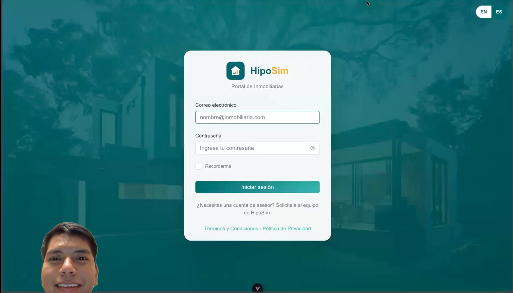
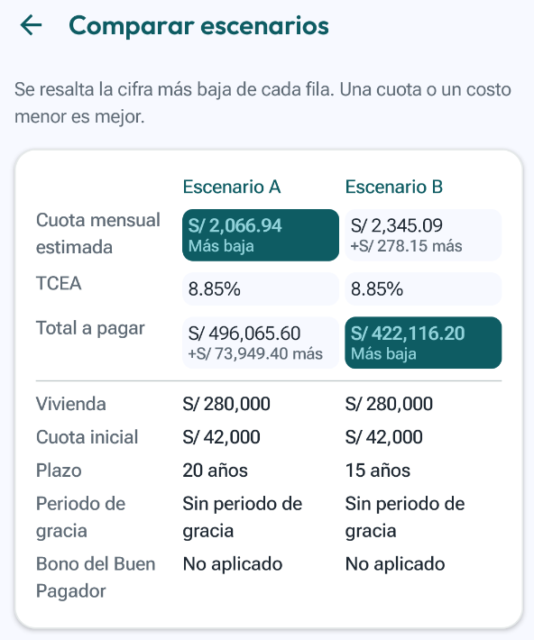
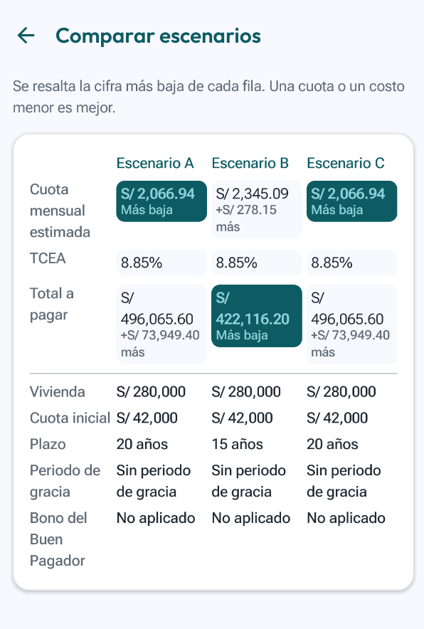
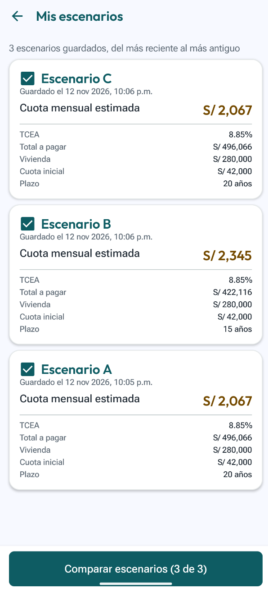

# **Capítulo VI: Product Verification & Validation**

## **6.1. Testing Suites & Validation**

Para garantizar la confiabilidad de HipoSim, estructuramos nuestra estrategia de verificación y validación alrededor de las funcionalidades que aportan mayor valor al comprador de primera vivienda y al asesor inmobiliario: el cálculo del crédito hipotecario, la presentación de sus indicadores financieros, la aplicación de beneficios estatales y el intercambio de simulaciones exclusivamente mediante consentimiento. Nuestro criterio central es comprobar tanto la exactitud de los resultados como la integridad de los datos personales utilizados durante estos procesos.

Distinguimos cuatro niveles de prueba complementarios. Las **pruebas unitarias** se concentran en reglas y componentes aislados; las **pruebas de integración** examinan la comunicación entre capas y productos; los escenarios de **Behavior-Driven Development (BDD)** traducen los criterios de aceptación en comportamientos verificables; y las **pruebas de sistema** evalúan los recorridos completos que experimentan los usuarios. Este enfoque mantiene la trazabilidad con las historias de usuario y las historias técnicas del Capítulo III, la arquitectura del Capítulo IV y los avances de implementación del Capítulo V.

La solución abarca una Landing Page desarrollada con HTML5, CSS3 y JavaScript; el portal web del asesor, desarrollado con Vue 3, Vite, PrimeVue, Pinia y axios; una aplicación Android nativa con Kotlin, Jetpack Compose, Hilt, Navigation Compose y ViewModel con StateFlow; y una API diseñada con ASP.NET Core, Entity Framework Core y PostgreSQL. Al cierre del Sprint 3 los cuatro productos están publicados: el Landing Page en GitHub Pages, el portal del asesor en Vercel, la API con PostgreSQL en Render y la aplicación Android en Firebase App Distribution. El móvil y el portal web consumen la API desplegada.

<div style="page-break-after: always;"></div>

| Nivel de verificación | Componentes y procesos prioritarios | Historias relacionadas | Criterio de aceptación |
|---|---|---|---|
| Unit Testing | Método francés, conversión de tasas, cálculo de indicadores, validación de entradas y elegibilidad al BBP | US01, US02, US04, US05, US15, SP02 | Reglas matemáticas y de negocio correctas de manera aislada |
| Integration Testing | Autenticación, servicio de simulación, persistencia, consentimiento, API y clientes web/móvil | TS02, TS06, TS07, TS08, US21–US25 | Intercambio de datos coherente y aplicación de permisos entre componentes |
| Behavior-Driven Development | Simulación sin registro, validación de cuota inicial, aplicación del BBP y gestión autorizada de leads | US01, US05, US15, US21, US23–US25 | Cumplimiento de escenarios expresados en lenguaje del dominio |
| System Testing | Navegación del sitio, resultados hipotecarios, acceso móvil y recorrido comprador–asesor | US14–US20, US13, US26, US21–US25 | Recorridos funcionales y seguros, con manejo comprensible de errores |

Al cierre del Sprint 3 contamos con los siguientes resultados de ejecución, todos en verde:

| Producto | Suite | Pruebas | Ejecución |
|---|---|---:|---|
| API | `HipoSim.FinancialEngine.Tests` (motor financiero) | 109 | `dotnet test` sobre `develop` |
| API | `HipoSim.Simulations.Tests` (simulación, gracia y reporte PDF) | 118 | `dotnet test` sobre `develop` |
| API | `HipoSim.Api.Tests` (endpoints, autenticación, leads, escenarios, eventos y conformidad con OpenAPI) | 76 | `dotnet test` sobre `develop` |
| Aplicación Android | Pruebas unitarias (`testDebugUnitTest`) | 292 | GitHub Actions en cada Pull Request, junto con `ktlint` y Android Lint |
| Portal web | Pruebas unitarias y de componentes (`npm test`) | Suite del repositorio | GitHub Actions en cada Pull Request, junto con lint y verificación de tipos |

En total, la API suma **303 pruebas** y la aplicación Android **292 pruebas unitarias**, además de sus pruebas de interfaz instrumentadas.

<div style="page-break-after: always;"></div>

### **6.1.1. Core Entities Unit Tests**

Organizamos las pruebas unitarias alrededor de las entidades y servicios de mayor criticidad financiera: `Property`, `Simulation`, `AmortizationEntry`, `FinancialIndicatorResult`, `StateBenefit` y `AdminParameter`, así como los componentes de cálculo `FinancialEngine` y `BenefitsEngine`. El aislamiento de estas reglas impide que errores de interfaz, comunicación o almacenamiento oculten defectos de cálculo. En el cliente Android, las pruebas de lógica y estado se separan de las pruebas de interfaz para comprobar los cambios de estado del `ViewModel` sin depender de la navegación completa.

La principal regla de simulación corresponde al método de amortización francés, con cuotas periódicas calculadas a partir del capital financiado, la tasa efectiva periódica y el plazo. Usamos la siguiente expresión como referencia de consistencia del motor financiero:

\[
C=P\frac{i(1+i)^n}{(1+i)^n-1}
\]

Donde `C` es la cuota periódica, `P` representa el capital financiado, `i` es la tasa efectiva del periodo y `n` corresponde al número de cuotas. Para convertir una tasa efectiva anual (`TEA`) a una tasa mensual efectiva, aplicamos:

\[
i=(1+TEA)^{1/12}-1\]

La fórmula supone un escenario de amortización regular, sin gracia ni cargos adicionales integrados en la cuota. Los seguros, comisiones y otros cargos se consideran por separado en el cálculo del costo efectivo total cuando corresponden. La TCEA no debe tratarse como equivalente a la TEA si existen costos adicionales.

<div style="page-break-after: always;"></div>

**Matriz de casos unitarios del núcleo funcional**

| ID | Clase o componente | Comportamiento bajo prueba | Datos y condición | Resultado esperado | Referencia |
|---|---|---|---|---|---|
| UT-01 | `Property` / validación de entrada | Validar el valor de la vivienda | Precio igual a cero o negativo | Rechazo del dato de entrada; no se inicia el cálculo | US01, TS06 |
| UT-02 | `Simulation` | Verificar la cuota inicial mínima | Cuota inicial inferior al 10 % del precio | Error de validación que informa el mínimo permitido | US01, TS06 |
| UT-03 | `Simulation` | Aceptar el límite de cuota inicial | Cuota inicial exactamente del 10 % | Entrada aceptada cuando los restantes datos son válidos | US01 |
| UT-04 | `FinancialEngine` | Convertir TEA a tasa efectiva mensual | TEA positiva expresada en forma decimal | Resultado consistente con `(1 + TEA)^(1/12) - 1` | US01, SP02 |
| UT-05 | `FinancialEngine` | Obtener la cuota francesa sin periodo de gracia | Capital positivo, tasa válida y 240 cuotas | Cuota positiva y consistente con el cálculo de referencia | US01, SP02 |
| UT-06 | `AmortizationEntry` | Distribuir capital e intereses | Primera cuota de un cronograma regular | Interés calculado sobre el saldo inicial y amortización igual a cuota menos interés | US02 |
| UT-07 | `Simulation` | Liquidar el préstamo al final del plazo | Cronograma completo del crédito | Saldo final igual a cero, considerando el ajuste de redondeo de la última cuota | US02 |
| UT-08 | `StateBenefit` / `BenefitsEngine` | Aplicar el Bono del Buen Pagador | Vivienda elegible y bono activado | Reducción del capital financiado y recálculo de la cuota | US05, US15 |
| UT-09 | `StateBenefit` / `BenefitsEngine` | Rechazar beneficio fuera de rango | Vivienda que no cumple el rango configurado | No se aplica el bono ni se altera el préstamo original | US05 |
| UT-10 | `FinancialIndicatorResult` | Comprobar coherencia de indicadores | Escenario válido con costos financieros | VAN, TIR y TCEA generados a partir de flujos consistentes | US04 |
| UT-11 | `Simulation` / `FinancialEngine` | Calcular gracia parcial | Tres meses de gracia parcial | Pago de intereses durante los tres primeros meses y cuota posterior recalculada | US03 |
| UT-12 | `Simulation` / `FinancialEngine` | Calcular gracia total | Tres meses de gracia total | Ausencia de pagos iniciales y capitalización de intereses | US03 |
| UT-13 | Lógica de autorización y consentimiento | Impedir la creación de un lead no autorizado | Consentimiento ausente o falso | No se habilita el envío ni se genera un lead | US21, TS08 |
| UT-14 | Estado de sesión Android | Restringir una operación de usuario registrado | Comprador sin sesión activa | Se solicita autenticación antes de compartir una simulación | US13, US21, US26 |

Para establecer un caso de referencia reproducible empleamos los datos de simulación definidos en la documentación de la API: vivienda de **S/ 280 000**, cuota inicial de **S/ 42 000**, TEA de **8,5 %**, plazo de **240 meses** y ausencia de periodo de gracia. El capital inicial, antes de cualquier subsidio, es **S/ 238 000**. Si el escenario es elegible y el beneficio aplicado asciende a **S/ 18 200**, el capital pasa a **S/ 219 800**. Estas igualdades constituyen verificaciones determinísticas del cálculo del principal; la cuota, los indicadores y el cronograma deben contrastarse con el motor de referencia y con la definición efectiva de seguros y redondeos.

También utilizamos pruebas de límites: cuota inicial exactamente igual al mínimo, precio de vivienda en los extremos de un rango de beneficio, tasas válidas muy bajas, plazos en sus valores extremos admitidos y redondeo de centavos. En las verificaciones del cronograma comprobamos las invariantes `cuota = interés + amortización`, `saldo final = saldo inicial - amortización` y la conservación del capital amortizado. La comparación con el proyecto de referencia **AutoFinance Pro** forma parte de la historia técnica SP02 y permite detectar diferencias introducidas al portar las fórmulas financieras a C#.

Los casos UT-01 a UT-12 están cubiertos por las suites `HipoSim.FinancialEngine.Tests` y `HipoSim.Simulations.Tests` de la API, incluidos los de gracia parcial y total (UT-11 y UT-12), que fijan la cuota esperada de los ejemplos del contrato. Los casos UT-13 y UT-14 están cubiertos por las pruebas unitarias de la aplicación Android, donde los casos de uso de envío a inmobiliarias y de guardado de escenarios rechazan la operación sin sesión o sin consentimiento.

<div style="page-break-after: always;"></div>

### **6.1.2. Core Integration Tests**

Definimos nuestras pruebas de integración a partir de las dependencias entre el motor de cálculo, los servicios de aplicación, los controladores REST, el acceso a PostgreSQL y los clientes que consumen los endpoints. El objetivo es detectar discrepancias que no son visibles durante las pruebas unitarias, tales como transformaciones incorrectas de datos, pérdida de consentimiento, problemas de autenticación, filtrado insuficiente de leads o respuestas incompatibles con los modelos del frontend.

El contrato REST diseñado en la sección 5.2.6 constituye la base de las verificaciones. Las peticiones de simulación utilizan `POST /api/simulations`; el registro y el inicio de sesión utilizan `POST /api/auth/register` y `POST /api/auth/login`; mientras que el flujo comercial utiliza `POST /api/leads`, `GET /api/leads`, `GET /api/leads/{id}` y `PATCH /api/leads/{id}/status`.

| ID | Integración | Solicitud o evento | Verificación esperada | Historias |
|---|---|---|---|---|
| IT-01 | Controlador de simulación → motor financiero | `POST /api/simulations` con datos válidos | HTTP 200 y respuesta con cuota, indicadores y cronograma consistentes | US01, US02, US04, TS06 |
| IT-02 | Validación → API | Cuota inicial inferior al 10 % o campos obligatorios ausentes | HTTP 400 con información de validación; no se persiste una simulación inválida | US01, TS06 |
| IT-03 | Registro → servicio de usuarios → base de datos | `POST /api/auth/register` con usuario nuevo | HTTP 201 y usuario disponible para autenticación | US13, TS07 |
| IT-04 | Restricción de unicidad → base de datos | Registro de correo electrónico ya existente | HTTP 409; no se duplica el usuario | TS07 |
| IT-05 | Autenticación → emisión de token | Credenciales correctas e incorrectas | HTTP 200 con JWT válido o HTTP 401, según el caso | US22, US26, TS07 |
| IT-06 | Comprador → API de leads → persistencia | `POST /api/leads` con consentimiento expreso | HTTP 201, lead generado y consentimiento asociado a la operación | US21, TS08 |
| IT-07 | Validación de privacidad → API de leads | Solicitud de envío sin consentimiento | HTTP 400 y ausencia de lead registrado | US21, TS08 |
| IT-08 | Asesor → API de leads → autorización | `GET /api/leads` con token del asesor | HTTP 200 y solamente los leads permitidos para su inmobiliaria | US23, TS08 |
| IT-09 | Middleware de autenticación → API | Consulta de leads sin token | HTTP 401 y ausencia de datos personales en la respuesta | US23, TS08 |
| IT-10 | Portal Vue → API | Apertura de bandeja, ficha y actualización de estado | Datos mostrados y actualizados de acuerdo con la respuesta del servicio | US23, US24, US25 |
| IT-11 | Aplicación Android → API | Simulación autenticada o anónima, según la operación | Estado del `ViewModel` y resultados compatibles con el contrato REST | US01, US04, US26 |
| IT-12 | Entity Framework Core → PostgreSQL | Escritura y lectura de una simulación o lead | Persistencia y recuperación sin alterar importes, propietarios ni permisos | TS02, TS08 |

**Contrato representativo de simulación**

```json
{
  "propertyPrice": 280000.00,
  "downPayment": 42000.00,
  "annualEffectiveRate": 0.085,
  "termInMonths": 240,
  "gracePeriodMonths": 0,
  "graceType": "none",
  "applyGoodPayerBonus": true
}
```

La respuesta satisfactoria debe identificar la simulación, informar el capital financiado y la cuota, devolver los indicadores de evaluación y proporcionar el cronograma correspondiente. El resultado no puede considerarse correcto solamente por recibir HTTP 200: los importes deben conservar sus relaciones matemáticas, la elegibilidad al beneficio debe respetar los parámetros vigentes y la estructura del JSON debe resultar compatible con la interfaz consumidora.

El flujo de integración más importante combina el envío voluntario de una simulación por parte del Comprador con la consulta posterior del Asesor. Verificamos este contrato en dos sentidos: un consentimiento válido habilita la creación del lead y su visualización dentro del ámbito autorizado; la ausencia de consentimiento impide el registro y la divulgación. Asimismo, una inmobiliaria no debe acceder a contactos pertenecientes a otra organización mediante el cambio de identificadores o la modificación de parámetros en la solicitud.

Las verificaciones IT-01 a IT-12 están automatizadas en `HipoSim.Api.Tests`, que levanta la API completa con `WebApplicationFactory` y comprueba los códigos de respuesta, la autorización por rol y la conformidad de cada respuesta con el contrato OpenAPI. Además, en el Sprint 3 agregamos pruebas para `POST /api/scenarios` y `GET /api/scenarios` (US06), `POST /api/events` (TS09) y `GET /api/simulations/{id}/report` (TS03, con respuestas 200, 403 y 404). Los recorridos de la aplicación móvil contra la API desplegada se documentan en el Capítulo V.

<div style="page-break-after: always;"></div>

### **6.1.3. Core Behavior-Driven Development**

Adoptamos BDD como mecanismo de comunicación entre requisitos, implementación y verificación. Cada escenario describe un comportamiento observable por el usuario o por el consumidor del servicio, sin incorporar detalles internos del código ni decisiones particulares de diseño de pantallas. La nomenclatura y el formato Gherkin permiten relacionar directamente las especificaciones con las historias de usuario del Product Backlog.

Los escenarios siguientes expresan las reglas principales de HipoSim con la estructura **Dado–Cuando–Entonces**. El texto es compatible con el dialecto español de Gherkin y mantiene los identificadores funcionales utilizados en el informe.

**Simulación hipotecaria sin registro — US01, US15 y TS06**

```gherkin
# language: es
@US01 @US15 @TS06 @simulation
Característica: Simulación hipotecaria básica
  Como comprador de primera vivienda
  Quiero calcular el costo estimado de mi crédito
  Para evaluar una alternativa antes de registrarme

  Escenario: Simulación válida sin cuenta de usuario
    Dado que el comprador no ha iniciado sesión
    Y que el precio de la vivienda es S/ 280000
    Y que la cuota inicial es S/ 42000
    Y que el plazo es de 240 meses
    Cuando solicita la simulación hipotecaria
    Entonces el sistema genera un cronograma de amortización
    Y presenta una cuota mensual estimada
    Y no exige el registro de una cuenta

  Escenario: Cuota inicial inferior al mínimo permitido
    Dado que el precio de la vivienda es S/ 280000
    Y que la cuota inicial es S/ 20000
    Cuando el comprador solicita la simulación
    Entonces el sistema rechaza los parámetros ingresados
    Y comunica que la cuota inicial mínima es del 10 por ciento
```
<div style="page-break-after: always;"></div>

**Bono del Buen Pagador — US05 y US15**

```gherkin
# language: es
@US05 @US15 @benefits
Característica: Evaluación del Bono del Buen Pagador
  Como comprador de primera vivienda
  Quiero evaluar el beneficio estatal aplicable
  Para conocer cómo afecta al monto financiado

  Escenario: Aplicación de un bono a una vivienda elegible
    Dado que la vivienda cumple los rangos vigentes del beneficio
    Y que el comprador solicita aplicar el Bono del Buen Pagador
    Cuando el sistema procesa la simulación
    Entonces el monto financiado disminuye según el bono aplicable
    Y la cuota mensual se recalcula con el nuevo capital

  Escenario: Vivienda fuera del rango admitido
    Dado que la vivienda no cumple los rangos vigentes del beneficio
    Cuando el comprador solicita aplicar el Bono del Buen Pagador
    Entonces el sistema informa que la vivienda no es elegible
    Y conserva el monto financiado sin subsidio
```

**Consentimiento para compartir la simulación — US21 y TS08**

```gherkin
# language: es
@US21 @TS08 @privacy
Característica: Intercambio autorizado de simulaciones
  Como comprador registrado
  Quiero decidir si comparto mi simulación con una inmobiliaria
  Para recibir contacto comercial solamente cuando lo autorice

  Escenario: Envío voluntario de la simulación
    Dado que el comprador tiene una sesión válida
    Y que dispone de una simulación completada
    Y que autoriza expresamente compartirla con una inmobiliaria
    Cuando solicita el envío de su simulación
    Entonces el sistema registra el consentimiento asociado al envío
    Y crea el lead para la inmobiliaria autorizada

  Escenario: Envío sin consentimiento
    Dado que el comprador tiene una simulación completada
    Y que no autoriza compartir sus datos
    Cuando intenta enviar su simulación a una inmobiliaria
    Entonces el sistema rechaza el envío
    Y no crea un lead
    Y no revela información financiera del comprador
```
<div style="page-break-after: always;"></div>

**Acceso y seguimiento de leads — US22, US23, US24, US25 y TS08**

```gherkin
# language: es
@US22 @US23 @US24 @US25 @TS08 @leads
Característica: Gestión segura de interesados inmobiliarios
  Como asesor de inmobiliaria
  Quiero consultar y dar seguimiento a los interesados autorizados
  Para atender sus solicitudes manteniendo la confidencialidad

  Escenario: Consulta de leads de la inmobiliaria autorizada
    Dado que el asesor ha iniciado sesión correctamente
    Y que existen leads autorizados para su inmobiliaria
    Cuando consulta su bandeja de interesados
    Entonces el sistema presenta los leads de su inmobiliaria
    Y no muestra los leads asociados a otras inmobiliarias

  Escenario: Actualización de seguimiento de un lead propio
    Dado que el asesor ha iniciado sesión correctamente
    Y que el lead pertenece a su inmobiliaria
    Cuando actualiza el estado de seguimiento del lead
    Entonces el sistema conserva el nuevo estado
    Y permite consultar el cambio realizado

  Escenario: Consulta sin autenticación
    Dado que el asesor no dispone de una sesión válida
    Cuando solicita la bandeja de interesados
    Entonces el sistema deniega el acceso
    Y no expone datos personales ni financieros
```

Para enlazar estos escenarios con la automatización, distinguimos la **especificación funcional** (archivo `.feature`), su **implementación ejecutable** (definiciones de pasos) y el **reporte de resultados**. Los escenarios aquí redactados constituyen especificaciones de aceptación; el informe actual no acredita todavía definiciones de pasos ejecutadas contra la API para cada uno de ellos. Esta distinción evita equiparar una historia redactada en Gherkin con una prueba automatizada que haya superado su ejecución.

Las reglas de privacidad se consideran transversales: el consentimiento tiene que ser explícito, la identidad del comprador debe estar autenticada para compartir y el asesor solamente puede acceder a los leads para los que posee autorización. Así preservamos la finalidad informativa de HipoSim y el tratamiento responsable de los datos personales descrito en la Ley N.° 29733.

<div style="page-break-after: always;"></div>

### **6.1.4. Core System Tests**

Las pruebas de sistema abarcan el comportamiento completo de los productos digitales y los recorridos que conectan al visitante, al comprador registrado y al asesor. Evaluamos la navegación, la validación de formularios, la visualización financiera, los permisos, la experiencia responsiva y la comunicación con servicios externos al cliente. Priorizamos las rutas que afectan directamente una decisión económica o que pueden exponer información personal.

| ID | Producto o recorrido | Procedimiento funcional | Resultado esperado | Alcance documentado |
|---|---|---|---|---|
| ST-01 | Landing Page | Acceder al sitio publicado y recorrer Inicio, Producto, Beneficios y Preguntas | Navegación disponible mediante HTTPS, enlaces operativos y contenido responsivo | Landing Page publicada |
| ST-02 | Landing Page | Ejecutar una simulación básica sin registrarse | Presentación de cuota, préstamo neto y TCEA referencial sin solicitar cuenta | Función descrita en Sprint 1 |
| ST-03 | Landing Page | Cambiar entre español e inglés y navegar por las secciones | Traducciones visibles y conservación de la preferencia mediante `localStorage` | Función descrita en Sprint 1 |
| ST-04 | Landing Page + API | Enviar el formulario de contacto, primero incompleto y luego completo | Validación de los campos y registro del mensaje con `POST /api/contact-messages` | Verificado contra la API desplegada (US19) |
| ST-05 | Android | Consultar resultados y abrir el registro contextual | Estados y navegación coherentes, incluso con sesión simulada | Pantallas implementadas en Sprint 1 |
| ST-06 | Android + API | Registrarse, autenticarse y simular desde el móvil | Sesión real, cálculo devuelto por la API y resultados consistentes | Verificado contra la API desplegada |
| ST-07 | Android + API | Compartir una simulación tras aceptar el consentimiento | Lead generado solamente después de la autorización expresa | Verificado contra la API desplegada |
| ST-08 | Portal web + API | Iniciar sesión como asesor y consultar bandeja y ficha | Visualización de leads autorizados provenientes de la API | Verificado contra la API desplegada |
| ST-09 | Portal web + API | Actualizar el estado de un lead y consultar el seguimiento | Cambio persistente sin afectar leads de otras inmobiliarias | Verificado contra la API desplegada |
| ST-10 | Recorrido transversal | Intentar compartir sin consentimiento o consultar leads sin token | Operaciones rechazadas y ausencia de exposición de datos | Criterio de seguridad transversal |
| ST-11 | Web y Android | Interrumpir o hacer fallar una solicitud de servicio | Error comprensible y estado de interfaz coherente, sin confirmar una operación fallida | Criterio de robustez |
| ST-12 | Android | Ejecutar pruebas automatizadas de interfaz en emulador | Verificación de los flujos de interfaz incluidos en la suite móvil | Pruebas de interfaz instrumentadas de la suite móvil |
| ST-13 | Android + API | Simular con gracia parcial y total, guardar dos escenarios, compararlos y descargar el PDF | Cronograma con los meses de gracia marcados, escenarios listados, diferencias resaltadas y PDF con resumen y cronograma | Sprint 3 (US03, US06, US07 y US08) |
| ST-14 | Landing Page y Android | Usar los productos y revisar la tabla `usage_events` | Eventos anónimos registrados, sin datos personales | Sprint 3 (TS09, TS10a y TS10b) |


<div style="page-break-after: always;"></div>

## **6.2. Static Code Analysis & Verification**

Complementamos las pruebas con análisis estático en cada producto. En la aplicación Android y en el portal web, el análisis se ejecuta en cada Pull Request dentro de la integración continua; en la API lo ejecutamos sobre la integración de las ramas del Sprint 3 con las herramientas del SDK de .NET 9.

### **6.2.1. Coding Standard & Code Conventions**

| Producto | Estándar | Herramienta que lo verifica |
|---|---|---|
| Aplicación Android | Convenciones oficiales de Kotlin y reglas de Compose | `ktlint` y Android Lint (`lintDebug`) |
| Portal web | Reglas de ESLint para Vue 3 y TypeScript | `npm run lint` y `npm run type-check` |
| API | Convenciones de C# de .NET y reglas de calidad CA | Analizadores de .NET en modo Recommended y `dotnet format` |
| Todos | Conventional Commits y GitFlow | Revisión de cada Pull Request |

### **6.2.2. Code Quality & Code Security**

Resultados del análisis estático de la API, medidos el 9 de noviembre de 2026 sobre la integración de las ramas de US03 y TS03 (documento `docs/bdd-and-static-analysis.md` del repositorio de la API):

| Revisión | Comando | Resultado |
|---|---|---|
| Compilación con analizadores por defecto | `dotnet build` | 0 advertencias y 0 errores |
| Analizadores de .NET en modo Recommended | `dotnet build -p:AnalysisMode=Recommended` | 179 advertencias y 0 errores |
| Formato | `dotnet format --verify-no-changes` | 651 hallazgos (621 de espacios en blanco y 30 sugerencias de estilo) |
| Paquetes con vulnerabilidades conocidas | `dotnet list package --vulnerable --include-transitive` | Ninguno, incluido QuestPDF 2026.9.1 |
| Paquetes en desuso | `dotnet list package --deprecated` | Solo `xunit 2.9.2`, marcado como Legacy |

| Hallazgo | Cantidad | Decisión |
|---|---:|---|
| CA1707, guiones bajos en nombres de pruebas | 166 | Aceptado: es la convención `Metodo_Cuando_Resultado` de las pruebas. |
| CA1305, conversión de texto sin cultura | 7 | Pendiente de riesgo bajo: se corrige con `CultureInfo.InvariantCulture` en las pruebas afectadas. |
| CA1822, CA1859, CA1869 y CA1050 | 6 | Aceptados: sugerencias de estilo o rendimiento sin efecto funcional. |
| Espacios en blanco en `HipoSim.Api` y sus pruebas | 621 | Se corrigen con `dotnet format whitespace`; ninguno está en el motor financiero. |

No se encontraron vulnerabilidades en las dependencias. Entre las medidas de seguridad verificadas por las pruebas están el rechazo de solicitudes sin token (401) o de otro rol (403), el límite de solicitudes por IP en el formulario de contacto y en los eventos de uso, y el rechazo de propiedades con nombres de datos personales en `POST /api/events`. Como limitación, no ejecutamos un analizador de seguridad dedicado (por ejemplo CodeQL); queda como mejora para el Sprint 4, junto con la ejecución de estos análisis en la integración continua de la API.

<div style="page-break-after: always;"></div>

## **6.3. Validation Interviews**

Las entrevistas de validación tienen como finalidad evaluar la experiencia de los usuarios al interactuar con las funcionalidades implementadas en HipoSim. Mediante estas entrevistas buscamos identificar dificultades de navegación, problemas de comprensión de los resultados financieros y oportunidades de mejora en la plataforma.

### **6.3.1. Diseño de entrevistas**

Para las entrevistas de validación se han elaborado preguntas dirigidas a los dos segmentos objetivo de HipoSim: compradores de primera vivienda y representantes de inmobiliarias.

Los participantes interactuarán con las funcionalidades correspondientes a su segmento y posteriormente responderán preguntas relacionadas con la facilidad de uso, claridad de la información, navegación y utilidad de la plataforma.

**Segmento objetivo: Compradores de primera vivienda**

1. ¿Qué impresión tuviste al ingresar por primera vez a HipoSim? ¿Comprendiste el propósito de la plataforma?
2. ¿Qué tan sencillo te resultó ingresar los datos para realizar una simulación hipotecaria?
3. ¿La aplicación te informó claramente cuando realizaste una simulación o guardaste un escenario?
4. ¿Qué términos financieros comprendiste y cuáles te resultaron difíciles de interpretar?
5. ¿Tuviste dificultades para regresar a una pantalla anterior, modificar los datos o realizar una nueva simulación?
6. ¿Encontraste fácilmente el cronograma de pagos y comprendiste la información presentada?
7. ¿Qué tan sencillo te resultó guardar y comparar diferentes escenarios hipotecarios?
8. Al comparar escenarios, ¿cómo identificaste cuál tenía la menor cuota mensual y cuál tenía el menor costo total?
9. ¿Encontraste errores, mensajes confusos o elementos visuales que dificultaran el uso de la aplicación?
10. ¿Qué mejorarías o agregarías en HipoSim para evaluar la compra de una vivienda?

**Segmento objetivo: Inmobiliarias**

1. ¿Qué impresión tuviste al ingresar por primera vez a la plataforma web de HipoSim?
2. ¿Te resultó sencillo identificar las funcionalidades disponibles en el menú de navegación?
3. ¿Qué tan fácil fue encontrar y revisar las solicitudes de los compradores interesados?
4. ¿La información presentada en cada solicitud te pareció suficiente para realizar un seguimiento comercial?
5. ¿Comprendiste los estados disponibles para gestionar las solicitudes de los compradores?
6. ¿Encontraste dificultades al actualizar el estado de una solicitud o registrar una nota de seguimiento?
7. ¿La información de la simulación hipotecaria te resultó clara y útil para conocer las necesidades del comprador?
8. ¿La plataforma te informó correctamente cuando realizaste una actualización?
9. ¿Encontraste errores o inconsistencias en la interfaz y sus funcionalidades?
10. ¿Qué funcionalidades o mejoras considerarías necesarias para utilizar HipoSim en tu trabajo?

Las respuestas obtenidas permitirán identificar oportunidades de mejora relacionadas con las heurísticas de usabilidad y evaluar si las funcionalidades implementadas responden a las necesidades de ambos segmentos objetivo.


<div style="page-break-after: always;"></div>

### **6.3.2. Registro de entrevistas**

En esta sección se registrarán las entrevistas de validación correspondientes a los segmentos objetivo de HipoSim, con la finalidad de evaluar la usabilidad, claridad y utilidad de las funcionalidades implementadas.

#### **Segmento 1: Comprador de Primera Vivienda**

<table>
    <thead>
        <tr>
            <th colspan="2">Entrevista #1</th>
        </tr>
    </thead>
    <tbody>
        <tr>
            <td>Nombre</td>
            <td>Pendiente </td>
        </tr>
        <tr>
            <td>Apellido</td>
            <td>Pendiente</td>
        </tr>
        <tr>
            <td>Edad</td>
            <td>Pendiente</td>
        </tr>
        <tr>
            <td>Evidencia</td>
            <td>Pendiente</td>
        </tr>
        <tr>
            <td>Link</td>
            <td>Pendiente</td>
        </tr>
        <tr>
            <td>Duración de la entrevista</td>
            <td> Pendiente </td>
        </tr>
        <tr>
            <td>Resumen</td>
            <td> Pendiente</td>
        </tr>
    </tbody>
</table>

<div style="page-break-after: always;"></div>

<table>
    <thead>
        <tr>
            <th colspan="2">Entrevista #2</th>
        </tr>
    </thead>
    <tbody>
        <tr>
            <td>Nombre</td>
            <td>Pendiente</td>
        </tr>
        <tr>
            <td>Apellido</td>
            <td>Pendiente</td>
        </tr>
        <tr>
            <td>Edad</td>
            <td>Pendiente</td>
        </tr>
        <tr>
            <td>Evidencia</td>
            <td>Pendiente</td>
        </tr>
        <tr>
            <td>Link</td>
            <td>Pendiente</td>
        </tr>
        <tr>
            <td>Duración de la entrevista</td>
            <td>Pendiente</td>
        </tr>
        <tr>
            <td>Resumen</td>
            <td>Pendiente</td>
        </tr>
    </tbody>
</table>

<div style="page-break-after: always;"></div>

#### **Segmento 2: Inmobiliarias**

<table>
    <thead>
        <tr>
            <th colspan="2">Entrevista #1</th>
        </tr>
    </thead>
    <tbody>
        <tr>
            <td>Nombre</td>
            <td>Carlos Alexander </td>
        </tr>
        <tr>
            <td>Apellido</td>
            <td>Pebe Dueñas</td>
        </tr>
        <tr>
            <td>Edad</td>
            <td>31</td>
        </tr>
        <tr>
            <td>Evidencia</td>
            <td><div align="center">
    
</div></td>
        </tr>
        <tr>
            <td>Link</td>
            <td>  <a href="<https://drive.google.com/file/d/1lBARHJ5aXndSZkgL7pgg14L03eFD84jq/view?usp=drive_link>">
        Entrevista Carlos Pebe
    </a></td>
        </tr>
        <tr>
            <td>Duración de la entrevista</td>
            <td>05:29 min</td>
        </tr>
        <tr>
            <td>Resumen</td>
            <td>
La entrevista con Carlos Pebe, de 31 años, asesor inmobiliario de Interbank, permitió evaluar la usabilidad y funcionalidad de la plataforma web **HipoSim** desde la perspectiva de un profesional con experiencia en el sector inmobiliario. El entrevistado destacó que la plataforma es **intuitiva, presenta funcionalidades simplificadas y facilita la interacción con los clientes**. Asimismo, identificó fácilmente las opciones del menú, el dashboard, la gestión de leads y las notificaciones.

Respecto a la gestión de solicitudes, señaló que resulta sencillo **consultar la información de los compradores, acceder a sus simulaciones hipotecarias, actualizar los estados y registrar notas de seguimiento**. No presentó dificultades durante estas actividades y confirmó que las actualizaciones de estado se reflejan correctamente en la plataforma. Además, consideró que la información financiera de las simulaciones es **clara y útil para conocer las necesidades del comprador antes de establecer una primera comunicación**.

El entrevistado considera que **HipoSim sería una herramienta de apoyo para facilitar el seguimiento de potenciales compradores y mejorar la comunicación con los clientes**. Durante la evaluación no identificó errores ni dificultades significativas, destacando que la información presentada es concisa, clara y suficiente para iniciar el contacto con el comprador. Finalmente, manifestó conformidad con el diseño visual y los colores utilizados, sin proponer cambios específicos en la interfaz.

#### Hallazgos importantes

- **Usabilidad:** la plataforma es intuitiva y sus funcionalidades son fáciles de identificar.
- **Navegación:** el dashboard, la gestión de leads y las notificaciones presentan una estructura sencilla.
- **Gestión de leads:** permite consultar fácilmente la información de los compradores y sus simulaciones hipotecarias.
- **Seguimiento de solicitudes:** no presentó dificultades al **actualizar estados o registrar notas de seguimiento**.
- **Información financiera:** los datos de las simulaciones permiten conocer las necesidades del comprador antes de establecer contacto.
- **Actualización de información:** los cambios de estado se reflejan correctamente en la plataforma.
- **Diseño visual:** manifestó conformidad con los colores y la presentación de la interfaz.
- **Errores identificados:** no reportó errores ni dificultades significativas durante la evaluación.
- **Validación de HipoSim:** considera que la plataforma facilita la **gestión de potenciales compradores, el seguimiento de solicitudes y la comunicación entre el asesor inmobiliario y el cliente**.</td>
  </tr>
    </tbody>
</table>

<div style="page-break-after: always;"></div>

<table>
    <thead>
        <tr>
            <th colspan="2">Entrevista #2</th>
        </tr>
    </thead>
    <tbody>
        <tr>
            <td>Nombre</td>
            <td>Selene</td>
        </tr>
        <tr>
            <td>Apellido</td>
            <td>Carhuayo</td>
        </tr>
        <tr>
            <td>Edad</td>
            <td>28</td>
        </tr>
        <tr>
            <td>Evidencia</td>
            <td>
                <div align="center">
                    
                </div>
            </td>
        </tr>
        <tr>
            <td>Link</td>
            <td>
                <a href="<https://drive.google.com/file/d/1cDnaxrUroIwLSk7pDJxnPiv8eSgKwPRx/view?usp=sharing>">
                    Entrevista Selene
                </a>
            </td>
        </tr>
        <tr>
            <td>Duración de la entrevista</td>
            <td>08:08 min</td>
        </tr>
        <tr>
            <td>Resumen</td>
            <td>

La entrevista con Selene, de 28 años, asesora inmobiliaria de RE/MAX, permitió evaluar la usabilidad y funcionalidad de la plataforma web **HipoSim** desde la perspectiva de una profesional del sector inmobiliario. La entrevistada destacó que la plataforma es **intuitiva, fácil de utilizar y presenta información detallada y organizada**. Asimismo, identificó fácilmente las funcionalidades del dashboard, la gestión de leads y las notificaciones, resaltando la facilidad para consultar el historial de cada comprador y conocer el estado de sus solicitudes.

Respecto al seguimiento comercial, consideró que los **estados disponibles se ajustan al proceso real de atención de clientes**, destacando la importancia de poder retomar el contacto con compradores previamente descartados. Además, señaló que la información de las simulaciones hipotecarias es **clara y suficientemente detallada**, especialmente en aspectos como el valor de la vivienda, las cuotas, los porcentajes y los bonos, facilitando su comprensión para compradores con conocimientos financieros básicos. También valoró las actualizaciones de estado y las notificaciones, debido a que permiten organizar el seguimiento de varios clientes simultáneamente.

La entrevistada considera que **HipoSim sería una herramienta útil para simplificar la gestión comercial y mejorar la atención de los compradores**. Comparó favorablemente su facilidad de uso con otros portales inmobiliarios que utiliza en RE/MAX, los cuales presentan mayores dificultades tanto para asesores como para clientes. Durante la evaluación no identificó errores específicos, aunque mostró interés en el acceso desde dispositivos móviles y en el funcionamiento de las notificaciones. Finalmente, destacó la importancia de mantener un **dashboard sencillo e intuitivo que facilite la atención y reduzca las dificultades de uso**.

#### Hallazgos importantes

- **Usabilidad:** la plataforma es intuitiva, sencilla y fácil de comprender desde el primer ingreso.
- **Navegación:** identificó fácilmente el dashboard, la gestión de leads y las notificaciones.
- **Gestión de leads:** la información y el historial de cada comprador se presentan de manera detallada y organizada.
- **Seguimiento comercial:** los estados disponibles se ajustan al proceso de atención utilizado por los asesores inmobiliarios.
- **Reactivación de solicitudes:** destacó la importancia de **retomar el seguimiento de clientes previamente descartados**.
- **Información financiera:** las simulaciones presentan información clara sobre el valor de la vivienda, las cuotas, los porcentajes y los bonos.
- **Actualizaciones y notificaciones:** considera que son útiles para gestionar y realizar el seguimiento de varios compradores simultáneamente.
- **Accesibilidad:** mostró interés en el acceso desde dispositivos móviles y en las notificaciones asociadas.
- **Ventaja competitiva:** considera que HipoSim es **más sencillo de utilizar que otros portales inmobiliarios con los que trabaja actualmente**.
- **Errores identificados:** no reportó errores ni inconsistencias específicas durante la evaluación.
- **Validación de HipoSim:** considera que la plataforma facilita la **gestión comercial, el seguimiento de potenciales compradores y la comprensión de las simulaciones hipotecarias**, beneficiando tanto a los asesores como a los clientes.
  </td>
  </tr>
    </tbody>
</table>

**Validación complementaria de los productos**

Durante las entrevistas, ambos asesores interactuaron con la plataforma de gestión inmobiliaria de HipoSim, ejecutada en un entorno local. Se evaluaron el dashboard, la consulta de leads, los cambios de estado y el envío de informes. También se presentó la aplicación móvil dirigida a los compradores de primera vivienda, mostrando el proceso de simulación hipotecaria y la información financiera disponible. Ambos asesores manifestaron una valoración favorable de esta aplicación. Esta demostración complementó la validación de la plataforma inmobiliaria y permitió conocer su percepción sobre la solución integral de HipoSim.


<div style="page-break-after: always;"></div>

### **6.3.3. Evaluaciones según heurísticas**

La evaluación heurística de HipoSim tiene como finalidad identificar problemas de usabilidad que puedan afectar la experiencia de los compradores de primera vivienda y los asesores inmobiliarios.

Para esta evaluación se consideran los principios de usabilidad de Jakob Nielsen, con el propósito de identificar oportunidades de mejora en la navegación, presentación de información, consistencia visual y prevención de errores.

**Aplicación para evaluar:** HipoSim.

**Tareas por evaluar:**

- Realizar una simulación hipotecaria.
- Interpretar los indicadores financieros.
- Consultar el cronograma de pagos.
- Guardar diferentes escenarios hipotecarios.
- Comparar dos o tres escenarios guardados.
- Identificar las alternativas con menor cuota mensual y menor costo total.
- Descargar el reporte de una simulación.
- Consultar y gestionar las solicitudes de compradores interesados desde la plataforma web.

**Escala de severidad**

<table>
    <thead>
        <tr>
            <th colspan="5">Escala de severidad</th>
        </tr>
        <tr>
            <th>1</th>
            <th>2</th>
            <th>3</th>
            <th>4</th>
            <th>5</th>
        </tr>
    </thead>
    <tbody>
        <tr>
            <td>No tan grave</td>
            <td>Leve</td>
            <td>Moderado</td>
            <td>Grave</td>
            <td>Muy grave</td>
        </tr>
    </tbody>
</table>

**Tabla de resumen**

La siguiente tabla presenta los problemas preliminares identificados durante las pruebas técnicas de la aplicación móvil. La severidad asignada corresponde a una valoración inicial del equipo y podrá actualizarse después de las entrevistas de validación.

| #Orden | Problema | Escala de severidad | Heurística evaluada | Estado |
|---|---|---|---|---|
| #1 | Redondeo de los importes monetarios en la comparación de escenarios. | 3 | Consistencia y estándares | Corregido |
| #2 | Resaltado de un único escenario cuando existen valores mínimos empatados. | 3 | Consistencia y estándares | Corregido |
| #3 | Distribución de importes extensos en varias líneas al comparar tres escenarios. | 2 | Diseño estético y minimalista | Pendiente |
| #4 | Diferencia de precisión monetaria entre la lista de escenarios y la pantalla de comparación. | 2 | Consistencia y estándares | Pendiente |

<div style="page-break-after: always;"></div>

**Heurísticas y recomendaciones**

**Problema #1: Redondeo de los importes monetarios en la comparación de escenarios.**

- **Heurística evaluada:** Consistencia y estándares.
- **Descripción del problema:** Los importes correspondientes a las cuotas mensuales, costos totales y diferencias monetarias se presentaban redondeados, dificultando la identificación de diferencias pequeñas entre escenarios hipotecarios.
- **Recomendación:** Presentar los importes monetarios con dos decimales para facilitar una comparación precisa.
- **Solución implementada:** Se modificó el formato monetario de la pantalla de comparación para conservar los céntimos en las cuotas mensuales, costos totales y diferencias.
- **Estado:** Corregido y validado mediante pruebas unitarias y de interfaz.

**Evidencia:**


<div align="center">
    
</div>

<div style="page-break-after: always;"></div>

**Problema #2: Resaltado de un único escenario cuando existen valores mínimos empatados.**

- **Heurística evaluada:** Consistencia y estándares.
- **Descripción del problema:** Cuando dos escenarios presentaban el mismo valor mínimo, la interfaz resaltaba únicamente uno de ellos. Esto podía generar una interpretación incorrecta sobre cuál era la alternativa más conveniente.
- **Recomendación:** Resaltar todos los escenarios que compartan el menor valor de un indicador. Cuando todos los escenarios presenten el mismo valor, evitar destacar alguno de ellos.
- **Solución implementada:** Se actualizó la lógica de comparación para reconocer los valores mínimos empatados y conservar una presentación neutral cuando todos los valores sean iguales.
- **Estado:** Corregido y validado mediante pruebas unitarias y de interfaz.

**Evidencia:**


<div align="center">
    
</div>


<div style="page-break-after: always;"></div>

**Problema #3: Distribución de importes extensos en varias líneas.**

- **Heurística evaluada:** Diseño estético y minimalista.
- **Descripción del problema:** Al comparar tres escenarios hipotecarios, algunos importes monetarios ocupan varias líneas debido al espacio disponible en las columnas de la pantalla.
- **Recomendación:** Mejorar la distribución de las columnas y adaptar el tamaño de los textos para mantener la legibilidad de los resultados.
- **Estado:** Pendiente de mejora.

**Evidencia:**


<div align="center">
    
</div>

<div style="page-break-after: always;"></div>

**Problema #4: Diferencia de precisión monetaria entre pantallas.**

- **Heurística evaluada:** Consistencia y estándares.
- **Descripción del problema:** La lista de escenarios guardados presenta importes monetarios redondeados, mientras que la pantalla de comparación presenta los valores con dos decimales.
- **Recomendación:** Unificar el formato monetario utilizado en ambas pantallas para mantener la consistencia de la información financiera.
- **Estado:** Pendiente de mejora.

**Evidencia:**

<div align="center">
    
</div>

<div align="center">
    
</div>